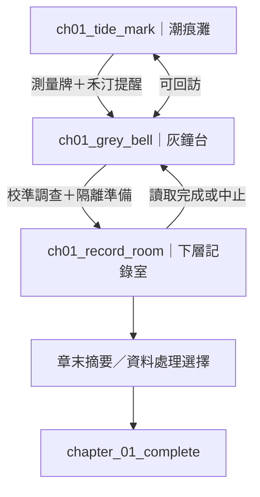
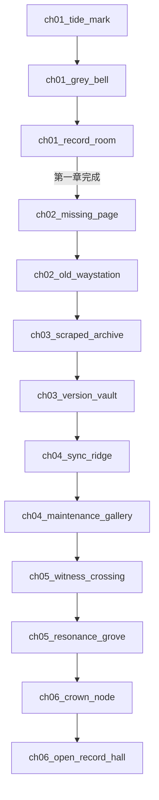

# 《零界紀元：THE UNWRITTEN WORLD》場景目錄

> 文件狀態：正式場景規劃基準 v1.0  
> 製作狀態：**第一章三個場景為優先製作範圍；其餘場景僅為後續規劃，不代表已製作。**  
> 專案路徑：`docs/05_SCENE_CATALOG.md`  
> 對齊文件：`00_PROJECT_MASTER.md`、`01_WORLD_BIBLE.md`、`02_STORY_BIBLE.md`、`03_GAMEPLAY_SPEC.md`、`06_JSON_SCHEMA.md`、`07_ART_BIBLE.md`、`08_TECH_SPEC.md`

---

## 0. 使用規則與決策狀態

### 0.1 本文件的用途

本文件定義遊戲場景節點、場景之間的合法連接、熱點功能、進出條件、角色與事件關係，以及美術資產需求。它是未來場景 JSON、互動內容與美術製作的來源文件。

- **[正式基準]**：本版採用的場景名稱、ID、第一章連接和必要互動。
- **[第一章必做]**：第一個可獨立測試、發布的可玩切片。
- **[後續規劃]**：先登錄，未要求第一章實作；可在製作後續章節時調整，但必須同步檢查出口、任務和線索依賴。
- **[待整合]**：實作前需與 JSON schema、角色文件或美術聖經確認欄位／細節；不得因此阻擋第一章。

### 0.2 衝突處理

1. 世界規則與歷史因果以 `01_WORLD_BIBLE.md` 為準。
2. 章節揭露、事件與選擇後果以 `02_STORY_BIBLE.md` 為準。
3. 點擊、對話、線索、旗標、任務與存檔行為以 `03_GAMEPLAY_SPEC.md` 為準。
4. 場景 ID、熱點 ID、出入口和本文件中的素材命名以本文件為基準。
5. 若未來資料格式無法表達某項規格，先記錄差異並提出最小修正；不得默默刪除劇情條件或建立不存在的出口。

### 0.3 製作範圍

| 範圍 | 數量 | 狀態 | 完成定義 |
|---|---:|---|---|
| 第一章核心場景 | 3 | **第一優先** | 可探索、互動、切換、回訪、取得線索並完成章節 |
| 第二章規劃場景 | 2 | 後續規劃 | 有獨立地方證據，將矛盾擴展到第二來源 |
| 第三章規劃場景 | 2 | 後續規劃 | 說明紀錄版本與認證制度 |
| 第四章規劃場景 | 2 | 後續規劃 | 以工程證據重建同步事故 |
| 第五章規劃場景 | 2 | 後續規劃 | 比對多方證詞與證據來源 |
| 第六章規劃場景 | 2 | 後續規劃 | 進行證據彙整和治理選擇 |

後續場景先採「每章兩個代表性節點」規劃，不是完整內容承諾。實際製作時，可在重用場景或合併功能的前提下調整。

---

## 1. 場景資料共通規範

### 1.1 ID 與命名

- 場景 ID 使用小寫英數與底線，格式建議為 `chNN_short_name`。
- 場景 ID 一旦被存檔、任務或事件引用，不得為了改顯示名稱而更改。
- 熱點 ID 在同一場景內唯一，建議使用 `scene_id` 的簡短前綴加物件名，例如 `tide_marker`。
- 出口目的地只能引用本文件「全遊戲場景清單」中存在的 ID。
- 顯示名稱可以翻修，ID 不可重複使用或回收給另一個場景。

### 1.2 場景組成

每個場景由以下部分組成：

1. 一張主背景圖；若圖片載入失敗，顯示可讀的純色／漸層備援。
2. HTML/CSS 呈現的標題、描述、熱點標籤、對話、任務、線索簿與設定介面。
3. 一組可點擊熱點，包含描述、前置條件、互動結果與完成狀態。
4. 零個或多個出口；未解鎖出口必須顯示鎖定原因或明確提示。
5. 可選的前景透明層、簡單霧氣／微光動畫或環境音；這些皆不可成為主線完成條件。
6. 可保存的場景狀態，至少保留已觸發的一次性事件、裝置狀態和已調查的必要熱點。

### 1.3 座標與觸控

- 熱點位置使用相對百分比或容器座標，不使用固定螢幕像素作唯一定位依據。
- 主要熱點可點擊區域目標至少約 44×44 CSS px；小物件應加透明擴大區域與可讀標籤。
- 重要線索必須可由點擊與文字確認，不可只靠辨識圖片裡的微小像素。
- 場景構圖以 16:9 背景作基準，但需提供直向手機的重新排列或安全裁切。
- 熱點不要壓在底部主要 UI、瀏海安全區或瀏覽器工具列上。
- 必要互動不依賴懸停；觸控、鍵盤與螢幕閱讀操作都應有清楚回饋。

### 1.4 視覺層級定義

- **前景**：遮擋或框住視線的近距離物件，例如礁石、欄杆、碎木、桌沿；用於構圖，不可遮擋必要熱點。
- **中景**：主要可調查物件、角色、門、機械與建築。
- **遠景**：地平線、海面、山脈、城區輪廓、天空與環境霧層。
- **焦點**：每個場景最多設定 1 個主焦點與 2 個次焦點；必要線索要透過標籤或互動文字可被發現。

### 1.5 共用氣氛與 UI 資產

共用效果由 CSS 或少量透明圖層實現，不為每個熱點製作新圖片。

| 共用資產 ID | 檔名 | 用途 | 製作原則 |
|---|---|---|---|
| UI-01 | `ui_scene_frame.svg` | 場景標題、邊框與返回提示 | HTML/CSS 優先，SVG 僅作輕量裝飾 |
| UI-02 | `ui_hotspot_marker.svg` | 可互動熱點的聚焦提示 | 由 CSS 控制亮度與狀態 |
| UI-03 | `ui_clue_icon.svg` | 線索簿新條目提示 | 同一圖示重複使用 |
| UI-04 | `ui_exit_arrow.svg` | 出口方向與鎖定狀態 | 文字標籤必須可讀 |
| FX-01 | `fx_coastal_mist.png` | 海岸與低地的透明霧層 | 可選、低透明度，失敗不影響遊戲 |
| FX-02 | `fx_dust_motes.png` | 室內遺跡的微塵層 | 可重用，不要求逐粒子即時模擬 |
| FX-03 | `fx_soft_glow.png` | 界文構件局部微光 | 以透明覆層和 CSS 呼吸動畫呈現 |
| FX-04 | `fx_scanline_soft.png` | 讀取器介面細微掃描效果 | UI 層效果，不烙進背景 |
| FX-05 | `fx_fade_transition.css` | 場景切換淡入淡出 | 低動態設定可停用 |
| BG-BASE | `bg_fallback_gradient.css` | 背景圖片失敗時的備援 | 以色彩與簡短提示維持可操作性 |

---

## 2. 全遊戲場景清單

### 2.1 ID 索引

| Scene ID | 場景名稱 | 章節／區域 | 狀態 | 用途 |
|---|---|---|---|---|
| `ch01_tide_mark` | 潮痕灘 | 第 1 章／靜潮海岸 | **第一章必做** | 開場、地方生活、測量異常 |
| `ch01_grey_bell` | 灰鐘台 | 第 1 章／靜潮海岸 | **第一章必做** | 調查觀測站與解鎖下層入口 |
| `ch01_record_room` | 下層記錄室 | 第 1 章／靜潮海岸 | **第一章必做** | 低功率讀取、取得異常記錄 |
| `ch02_missing_page` | 缺頁村鎮 | 第 2 章／靜潮海岸外圍 | 後續規劃 | 地方年表與航路證據 |
| `ch02_old_waystation` | 舊路測站 | 第 2 章／靜潮海岸外圍 | 後續規劃 | 獨立測量來源與內陸方向 |
| `ch03_scraped_archive` | 刮痕檔案廳 | 第 3 章／斷冠城域外緣 | 後續規劃 | 被刪除的版本與認證印記 |
| `ch03_version_vault` | 版本封存庫 | 第 3 章／斷冠城域外緣 | 後續規劃 | 比對不同版本的記錄 |
| `ch04_sync_ridge` | 裂脊同步台 | 第 4 章／裂脊山地 | 後續規劃 | 同步環與校準差異 |
| `ch04_maintenance_gallery` | 維護廊道 | 第 4 章／裂脊山地 | 後續規劃 | 工程日誌與故障因果 |
| `ch05_witness_crossing` | 多證交會站 | 第 5 章／鏡鹽盆地商路 | 後續規劃 | 多方證詞與來源交叉比對 |
| `ch05_resonance_grove` | 殘響林徑 | 第 5 章／霧杉內陸 | 後續規劃 | 口述傳承、保存與記憶偏差 |
| `ch06_crown_node` | 斷冠主節點 | 第 6 章／斷冠城域 | 後續規劃 | 整合節點證據與公共風險 |
| `ch06_open_record_hall` | 未封合紀錄廳 | 第 6 章／斷冠城域 | 後續規劃 | 結局前的證據彙整與治理選擇 |

> 第一章實際製作只需要前三個場景。標題畫面、任務面板、線索簿、設定與存檔 UI 是介面，不算世界場景節點。

### 2.2 場景連接總表

所有出口的目的地均在上方索引中登錄。本表是出口引用的檢查基準。

| 起點 | 出口 ID | 目的地 | 開放條件 | 方向／性質 |
|---|---|---|---|---|
| `ch01_tide_mark` | `exit_to_grey_bell` | `ch01_grey_bell` | 完成開場測量；看過禾汀的安全提醒 | 主線前進 |
| `ch01_grey_bell` | `exit_to_tide_mark` | `ch01_tide_mark` | 無；回訪出口常開 | 回訪 |
| `ch01_grey_bell` | `exit_to_record_room` | `ch01_record_room` | 調查外部刻痕並啟用隔離程序 | 主線前進 |
| `ch01_record_room` | `exit_to_grey_bell` | `ch01_grey_bell` | 完成或中止本次讀取流程 | 回訪／安全返回 |
| `ch01_record_room` | `exit_to_ch02_missing_page` | `ch02_missing_page` | `chapter_01_complete` 為真 | 章節出口 |
| `ch02_missing_page` | `exit_to_old_waystation` | `ch02_old_waystation` | 找到缺頁年表中的路標 | 主線前進 |
| `ch02_old_waystation` | `exit_to_missing_page` | `ch02_missing_page` | 無；回訪出口常開 | 回訪 |
| `ch02_old_waystation` | `exit_to_scraped_archive` | `ch03_scraped_archive` | 確認第二份獨立日期證據 | 跨章前進 |
| `ch03_scraped_archive` | `exit_to_version_vault` | `ch03_version_vault` | 記錄認證印記與刮除痕跡 | 主線前進 |
| `ch03_version_vault` | `exit_to_scraped_archive` | `ch03_scraped_archive` | 無；回訪出口常開 | 回訪 |
| `ch03_version_vault` | `exit_to_sync_ridge` | `ch04_sync_ridge` | 比對至少兩份不同版本 | 跨章前進 |
| `ch04_sync_ridge` | `exit_to_maintenance_gallery` | `ch04_maintenance_gallery` | 取得同步台的校準讀數 | 主線前進 |
| `ch04_maintenance_gallery` | `exit_to_sync_ridge` | `ch04_sync_ridge` | 無；回訪出口常開 | 回訪 |
| `ch04_maintenance_gallery` | `exit_to_witness_crossing` | `ch05_witness_crossing` | 取得可交叉驗證的維護證據 | 跨章前進 |
| `ch05_witness_crossing` | `exit_to_resonance_grove` | `ch05_resonance_grove` | 整理兩個不同來源的證詞 | 主線前進 |
| `ch05_resonance_grove` | `exit_to_witness_crossing` | `ch05_witness_crossing` | 無；回訪出口常開 | 回訪 |
| `ch05_resonance_grove` | `exit_to_crown_node` | `ch06_crown_node` | 形成至少一份帶來源註記的綜合結論 | 跨章前進 |
| `ch06_crown_node` | `exit_to_open_record_hall` | `ch06_open_record_hall` | 完成節點風險檢查 | 主線前進 |
| `ch06_open_record_hall` | `exit_to_crown_node` | `ch06_crown_node` | 無；回訪出口常開 | 回訪 |

**連接限制：** 後續章節目前是代表性節點串接；不代表各區域間的交通、所有章節邊界或遊戲最終地圖已完成設計。未來新增場景時，先登錄 ID，再新增出口。不得只在單一場景文字中寫出一個未登錄的可進入地點。

---

## 3. 第一章場景規格（第一優先製作）

## 3.1 `ch01_tide_mark` — 潮痕灘

### 基本資料

- **所屬章節：** 第一章〈潮痕之下〉
- **區域：** 灰岸大陸／靜潮海岸
- **製作優先級：** P0，第一個製作
- **劇情用途：** 以沿岸測量這件平凡工作引入玩家；展示當地生活、歸航短線和近期異常讀數；介紹岸民禾汀；讓玩家獲得調查灰鐘台的合理動機。
- **情緒關鍵字：** 寧靜、潮濕、克制的不安、生活感。
- **進入條件：** 新遊戲開始後進入；存檔回訪時允許直接進入。
- **背景描述：** 灰岸大陸靜潮海岸的一段低潮灘地。潮水剛退，濕沙留下深淺不一的痕跡；舊測量牌和打撈木料散布在岸邊，遠處可見灰鐘台輪廓。居民的歸航短線刻在較高處的石面，與古代界文標記有明顯年代與用途差異。
- **視覺構圖與焦點：** 16:9 橫向廣角；主焦點為中景偏右的測量牌，次焦點為遠景偏左的灰鐘台輪廓和前景石面上的歸航短線。畫面左側留出出口標籤安全區，底部留出 UI 安全區。
- **前景：** 一小段濕礁石、被潮水磨圓的木料、歸航短線所在石面；避免過度遮擋。
- **中景：** 測量牌、潮位刻痕、少量打撈物、禾汀站立位置。
- **遠景：** 灰藍海面、低霧、灰鐘台剪影、雲層和海鳥小剪影（可省略）。
- **氣氛效果：** 共用海岸霧層 `FX-01`、緩慢水面亮度變化（CSS 或靜態即可）；不可要求流動海水模擬或影片。
- **所需美術：** `bg_ch01_tide_mark.webp`（主背景）；可選 `ov_ch01_tide_mark_foreground.png`（透明前景）；重用 `fx_coastal_mist.png`、`ui_hotspot_marker.svg`、`ui_exit_arrow.svg`。
- **素材注意：** 背景內不要生成可讀文字、UI、精確符號或清晰人物臉；測量刻度、歸航短線的必要可讀版本由 UI 疊層或熱點描述提供。

### 熱點規格

| Hotspot ID | 顯示標籤 | 類型 | 前置條件 | 互動結果／狀態變更 |
|---|---|---|---|---|
| `tide_marker` | 檢查潮位測量牌 | 必要調查 | 無 | 顯示讀數與當日潮況不完全吻合；設定 `ch01_tide_marker_checked`；任務更新 |
| `return_lines` | 查看歸航短線 | 可選觀察 | 無 | 說明這是當代居民的安全記號；新增環境筆記 CL-02（非主線必需） |
| `salvage_marks` | 查看打撈痕跡 | 可選觀察 | 無 | 描述木料磨損與近期水位；補強海岸生活感，不新增圖片 |
| `hetin_talk` | 與禾汀交談 | 必要對話 | 首次進入可用；已談過則顯示簡短重訪對話 | 介紹灰鐘台近況與安全提醒；設定 `ch01_hetin_warned` |
| `old_shore_marker` | 尋找舊岸標記錄 | 可選委託熱點 | 禾汀已提及委託 | 可選支線「找回岸標記錄」的調查步驟；完成後給地方潮況註記，不影響主線 |
| `exit_to_grey_bell` | 前往灰鐘台 | 出口 | `ch01_tide_marker_checked` 且 `ch01_hetin_warned` | 切換至 `ch01_grey_bell`；保留本場景互動狀態 |

### 進入、離開與完成條件

- **進入時：** 顯示章節目標「核對沿岸測量讀數」；首次進入顯示短環境描述，不自動播放長篇過場。
- **離開條件：** 已調查測量牌、已聽取禾汀安全提醒後，可前往灰鐘台。其他熱點和支線均非必要。
- **回訪條件：** 從灰鐘台返回時，已完成的必要互動保持完成；禾汀改用短版重訪對話。
- **場景完成標準：**
  1. 必要熱點可在手機與平板上點擊。
  2. 測量異常透過文字明確呈現，不要求玩家辨識小像素。
  3. 禾汀只提供當地觀察，不知道古代完整真相。
  4. 未做可選委託也能解鎖灰鐘台。
  5. 返回本場景後，必要狀態不重置、不重複發放線索。
  6. 背景載入失敗時仍可調查並離開。

## 3.2 `ch01_grey_bell` — 灰鐘台

### 基本資料

- **所屬章節：** 第一章〈潮痕之下〉
- **區域：** 靜潮海岸
- **製作優先級：** P0，第二個製作
- **劇情用途：** 確認灰鐘台原本是觀測與校準設施；引入無指針鐘、三道未封合圓弧、低功率回應和安全隔離概念；解鎖下層記錄室。
- **情緒關鍵字：** 靜止、風蝕、工程遺跡、克制的異常。
- **進入條件：** 從 `ch01_tide_mark` 完成測量與安全提醒後抵達。
- **背景描述：** 一座建在岩岸高處的古代潮汐觀測站。主體石造，局部嵌有已失去光澤的界文構件。外部平台有一座無指針鐘，牆面和金屬環上重複出現三道未封合圓弧。設備只有局部微弱反應，沒有整座建築啟動的景象。
- **視覺構圖與焦點：** 中遠景主焦點為觀測站門與無指針鐘；次焦點為左側環形校準構件和右下方通往下層的封閉入口。保持建築幾何可讀，避免過多奇幻尖塔或浮空物件。
- **前景：** 風蝕欄杆、少量碎石、平台邊緣。
- **中景：** 無指針鐘、界文環、入口隔離面板、磨損刻痕。
- **遠景：** 海岸線、海霧、潮痕灘方向和低雲。
- **氣氛效果：** 重用 `FX-01` 海霧與 `FX-03` 界文微光；光效只在已調查構件附近緩慢變化。可用輕微 CSS 亮度脈動，不需要 3D 機械動畫。
- **所需美術：** `bg_ch01_grey_bell.webp`（主背景）；可選 `ov_ch01_grey_bell_glow.png`（透明局部微光遮罩）；重用 `fx_coastal_mist.png`、`fx_soft_glow.png`、共用熱點與出口 UI。

### 熱點規格

| Hotspot ID | 顯示標籤 | 類型 | 前置條件 | 互動結果／狀態變更 |
|---|---|---|---|---|
| `bell_shell` | 檢查無指針鐘 | 必要調查 | 無 | 發現外殼與固定結構仍在，但不能正常計時；新增 CL-03 的已揭露部分；設定 `ch01_bell_checked` |
| `arc_inscription` | 查看三道圓弧 | 必要調查 | 無 | 記錄符號重複出現；不直接解釋其完整意義；設定 `ch01_arc_mark_checked` |
| `calibration_ring` | 檢查校準環 | 必要調查 | 已調查無指針鐘或圓弧之一 | 讀到局部低功率回應與校準偏差；設定 `ch01_ring_checked` |
| `isolation_panel` | 檢查隔離面板 | 必要操作 | 已調查 `calibration_ring` 且已查看另一個必要構件 | 顯示安全隔離步驟；玩家確認後設定 `ch01_isolation_ready`；不得以錯誤操作永久鎖死 |
| `lower_access` | 開啟下層入口 | 出口／操作 | `ch01_isolation_ready` | 開啟通往 `ch01_record_room` 的低功率通道 |
| `exit_to_tide_mark` | 返回潮痕灘 | 出口 | 無 | 切換至 `ch01_tide_mark` |
| `exit_to_record_room` | 進入下層記錄室 | 出口 | `ch01_isolation_ready` | 切換至 `ch01_record_room`；未符合條件時提示先檢查校準與隔離面板 |

### 進入、離開與完成條件

- **進入時：** 更新目標為「查明灰鐘台的回應來源」；用一段短描述指出局部設備仍有反應。
- **離開條件：** 前往記錄室前必須檢查校準環並準備隔離；返回潮痕灘不受此條件限制。
- **回訪條件：** 已檢查的物件保留已讀狀態；已啟用隔離程序後不得要求重複操作。
- **場景完成標準：**
  1. 無指針鐘、三道圓弧和校準環都可互動，且各自回饋不同。
  2. 玩家能理解這是古代工程設施，而不是純粹宗教遺跡。
  3. 隔離程序有明確文字步驟與成功回饋。
  4. 下層入口只在條件達成後開放，引用的目的地 ID 存在。
  5. 玩家可安全返回潮痕灘。
  6. 所有必要資訊由文字提供，微光動畫僅為裝飾。

## 3.3 `ch01_record_room` — 下層記錄室

### 基本資料

- **所屬章節：** 第一章〈潮痕之下〉
- **區域：** 靜潮海岸／灰鐘台下層
- **製作優先級：** P0，第三個製作
- **劇情用途：** 以有限且安全的低功率讀取取得第一份異常記錄；明確區分原始資料、殘響與玩家推論；觸發第一章結尾與資料處理選擇。
- **情緒關鍵字：** 封存、微光、安靜、證據初現。
- **進入條件：** 從 `ch01_grey_bell` 啟用隔離程序後進入。
- **背景描述：** 灰鐘台下層的一間狹窄記錄室，石壁與金屬支架保存著部分記錄模組。中央讀取器有磨損的介面和數個失效指示槽；牆面有維護痕跡與封存標籤。室內只有局部低功率，不存在完整全息投影或可自由交談的古代人格。
- **視覺構圖與焦點：** 中央偏右為記錄讀取器，左側為封存架，遠端牆面有磨損的維護標記。焦點集中在讀取器，周圍保留足夠暗部但不可讓熱點難以辨識。
- **前景：** 桌沿、線纜與少量碎屑。
- **中景：** 讀取器、封存架、隔離狀態燈、手動控制面板。
- **遠景：** 石壁、維護刻痕、被封住的舊通道。
- **氣氛效果：** 重用 `FX-02` 微塵與 `FX-03` 局部微光；讀取時可疊加 `FX-04` 細微掃描線。禁止以動畫作為閱讀記錄的唯一途徑。
- **所需美術：** `bg_ch01_record_room.webp`（主背景）；可選 `ov_ch01_record_reader_glow.png`（透明微光遮罩）；重用 `fx_dust_motes.png`、`fx_soft_glow.png`、`fx_scanline_soft.png` 與共用 UI。

### 熱點規格

| Hotspot ID | 顯示標籤 | 類型 | 前置條件 | 互動結果／狀態變更 |
|---|---|---|---|---|
| `reader_inspect` | 檢查記錄讀取器 | 必要調查 | 無 | 說明設備狀態與低功率限制；設定 `ch01_reader_inspected` |
| `archive_slots` | 查看封存槽 | 必要調查 | 無 | 發現部分槽位空缺或損壞；提示資料不完整；設定 `ch01_archive_slots_checked` |
| `maintenance_marks` | 閱讀維護刻痕 | 必要調查 | 無 | 取得一段局部維護註記，不能單獨證明事故全貌；設定 `ch01_maintenance_marks_checked` |
| `start_low_power_read` | 進行低功率讀取 | 必要操作 | 已檢查讀取器、封存槽與維護刻痕；`ch01_isolation_ready` 為真 | 顯示短而不完整的殘響文字；新增線索 CL-05／CL-06；加入「異常記錄碎片」線索簿條目；設定 `ch01_anomaly_record_found` |
| `record_handling_choice` | 處理異常記錄 | 必要選擇 | `ch01_anomaly_record_found` 為真 | 顯示三種資料處理選擇並寫入 `record_handling`；各選擇均能完成主線 |
| `exit_to_grey_bell` | 返回灰鐘台 | 安全出口 | 完成或明確中止讀取流程 | 切回 `ch01_grey_bell`；不得因未做可選熱點而阻止離開 |

### 第一章資料處理選擇

| 值 | 玩家選項 | 本章立即後果 | 後續可用差異 | 不可造成的結果 |
|---|---|---|---|---|
| `preserve_original` | 封存原始碎片，暫不分享 | 線索簿記錄原件保留；禾汀認為玩家謹慎 | 後續可先以原件比對；部分角色需要更多理由才信任摘要 | 不得阻止主線繼續 |
| `share_summary` | 分享經過標註的摘要 | 線索簿記錄已分享摘要；禾汀較願意協助 | 校勘院方向可較早出現；仍需驗證原件 | 不得讓所有人自動相信 |
| `mark_location_only` | 只記位置，暫不複製 | 保存位置與未複製註記 | 後續可回訪重讀或走替代驗證；成本為額外短回訪 | 不得永久失去必要線索 |

### 進入、離開與完成條件

- **進入時：** 顯示安全提醒與「確認讀取器狀態」目標。
- **離開條件：** 可隨時返回灰鐘台；第一章完成前必須取得異常記錄、設定 `record_handling`，並讀取章末摘要。
- **場景完成標準：**
  1. 三個必要調查熱點都可完成，且提示資料有缺漏。
  2. 讀取流程只呈現短文字片段，不需要影片或全螢幕動畫。
  3. 殘響被明確說明為不完整設備資料，而非全知人格。
  4. 異常記錄進入線索簿；即使玩家未拿到可攜帶物件，也不影響主線旗標。
  5. 三種選擇都能保存、回讀並完成章節。
  6. 重複點擊讀取不重複發放線索或重複觸發結尾。
  7. 章末提供下一步可驗證方向，不直接揭露第一次界潮全貌。

---

## 4. 後續章節場景規格（僅規劃，非第一章製作）

後續場景沿用第一章的資料結構與 UI。下列背景檔名是建議檔名，不表示圖片已生成或授權已確認。每個場景仍須在製作該章前補齊正式熱點座標、對話文本、任務旗標和測試結果。

## 4.1 `ch02_missing_page` — 缺頁村鎮

- **所屬章節／區域：** 第二章／靜潮海岸外圍。
- **劇情用途：** 將灰鐘台的單一日期矛盾與地方年表、航路記錄對照，建立第二個獨立來源。
- **進入條件：** 第一章完成；有 `ch01_anomaly_record_found` 或可由章末摘要恢復的替代證據。
- **背景描述：** 沿岸小聚落的公共記錄牆、修船棚與通往舊路的木牌；居民以潮況和航路記錄生活。
- **構圖焦點：** 中景記錄牆；次焦點為舊航路牌和修船棚。
- **前／中／遠景：** 前景繩索與木箱；中景記錄牆、告示牌；遠景屋頂、海岸與舊路。
- **氣氛效果：** 重用 `FX-01`；不需獨立粒子素材。
- **熱點與結果：** `local_yearboard` 比對地方年表；`route_ledger` 檢查航路記錄；`town_keeper_talk` 取得口述版本；`exit_to_old_waystation` 在找到年表缺頁標記後開放。
- **可通往：** `ch02_old_waystation`。
- **相關角色／任務／事件：** 地方記錄保管者（工作名稱待角色文件統一）；第二章主線「比對獨立來源」；EV-第二章地方證據事件（事件 ID 待統一）。
- **素材檔名：** `bg_ch02_missing_page.webp`；重用 `fx_coastal_mist.png` 和共用 UI。
- **進入／離開條件：** 第一章完成後進入；取得缺頁年表的路標後離開。
- **測試標準：** 至少兩種獨立來源可比較；玩家能看懂「矛盾不是單一設備故障」的結論；出口 ID 存在。

## 4.2 `ch02_old_waystation` — 舊路測站

- **所屬章節／區域：** 第二章／靜潮海岸外圍。
- **劇情用途：** 提供獨立的測量標記與第二份日期證據，為第三章的版本調查提供方向。
- **進入條件：** 從 `ch02_missing_page` 找到路標。
- **背景描述：** 被海風侵蝕的舊路測站，留下量測柱、簡單遮雨棚與封存盒。
- **構圖焦點：** 中景測量柱與封存盒。
- **前／中／遠景：** 前景碎石與路牌；中景測量柱、封存盒；遠景低丘和舊路。
- **氣氛效果：** 重用 `FX-01`，以靜態陰影呈現荒廢感。
- **熱點與結果：** `survey_column` 取得獨立日期刻痕；`sealed_box` 發現地方抄本殘頁；`road_map` 解鎖下一階段方向；`exit_to_missing_page` 回訪；`exit_to_scraped_archive` 在確認獨立證據後開放。
- **可通往：** `ch02_missing_page`、`ch03_scraped_archive`。
- **相關角色／任務／事件：** 第二章主線；CL-07。
- **素材檔名：** `bg_ch02_old_waystation.webp)；重用海岸背景效果與共用 UI。
- **進入／離開條件：** 有地方路標才進入；確認第二份獨立日期證據後可前往第三章。
- **測試標準：** 沒有取得可選對話也能找到必要證據；回訪不重複發放同一條目。

## 4.3 `ch03_scraped_archive` — 刮痕檔案廳

- **所屬章節／區域：** 第三章／斷冠城域外緣。
- **劇情用途：** 呈現被刮除的碑文、認證印記和版本選擇的痕跡，讓玩家開始理解紀錄不只是自然損毀。
- **進入條件：** 第二章完成；已確認至少兩份來源互相矛盾。
- **背景描述：** 半封閉檔案廳，石板、金屬標牌和多層檔案櫃仍在，但部分標記被磨除。
- **構圖焦點：** 刮痕石板與認證印記。
- **前／中／遠景：** 前景檔案匣；中景石板、印記、檔案櫃；遠景高窗與城域輪廓。
- **氣氛效果：** 重用 `FX-02` 微塵；不需新粒子圖。
- **熱點與結果：** `scraped_tablet` 記錄被刮除痕跡；`certification_seal` 解讀認證印記；`catalogue_drawer` 找到不同版本索引；`exit_to_version_vault` 在記錄兩類痕跡後開放。
- **可通往：** `ch03_version_vault`。
- **相關角色／任務／事件：** 第三章主線；CL-08。
- **素材檔名：** `bg_ch03_scraped_archive.webp)；重用 `fx_dust_motes.png) 和共用 UI。
- **進入／離開條件：** 第二章的獨立證據已登錄；取得刮痕和認證兩項記錄後前進。
- **測試標準：** 不直接宣布單一勢力有完整責任；必須保留制度需求與權力風險兩種解讀。

## 4.4 `ch03_version_vault` — 版本封存庫

- **所屬章節／區域：** 第三章／斷冠城域外緣。
- **劇情用途：** 以兩份或更多版本的可比較差異，證明某些紀錄曾被選擇、認證或排除。
- **進入條件：** 在刮痕檔案廳登錄認證印記與刮除痕跡。
- **背景描述：** 溫度穩定的封存空間，層架上有封條、版本匣和狀態標籤。
- **構圖焦點：** 桌面上並列的兩份版本匣。
- **前／中／遠景：** 前景桌面與標籤；中景版本匣和層架；遠景厚門與通風槽。
- **氣氛效果：** 重用 `FX-02`，以 UI 並排比較文本，不製作額外插畫。
- **熱點與結果：** `version_a` 讀取版本 A；`version_b` 讀取版本 B；`compare_versions` 顯示差異並要求標註來源；`exit_to_scraped_archive` 回訪；`exit_to_sync_ridge` 在完成比較後開放。
- **可通往：** `ch03_scraped_archive`、`ch04_sync_ridge`。
- **相關角色／任務／事件：** 第三章主線；CL-08。
- **素材檔名：** `bg_ch03_version_vault.webp)；重用 `fx_dust_motes.png) 和共用 UI。
- **進入／離開條件：** 已記錄兩類版本痕跡；至少完成一次版本比較後前往第四章。
- **測試標準：** 版本差異以文字或表格呈現，不要求玩家只憑顏色分辨；來源標籤不混淆。

## 4.5 `ch04_sync_ridge` — 裂脊同步台

- **所屬章節／區域：** 第四章／裂脊山地。
- **劇情用途：** 展示大型同步環、校準標記與地形應力，讓玩家開始以工程證據理解同步事故。
- **進入條件：** 第三章完成版本比較；取得通往裂脊山地的調查線索。
- **背景描述：** 山脊上的古代同步平台，環形構件嵌入岩床；部分支架變形，遠處可見舊維護道。
- **構圖焦點：** 中央同步環與變形支架。
- **前／中／遠景：** 前景碎石、護欄；中景同步環、校準柱；遠景山脊、雲霧和斷裂舊道。
- **氣氛效果：** 可重用 `FX-03` 微光；雲霧以 `FX-01` 低透明度變體呈現。
- **熱點與結果：** `sync_ring` 讀取環體偏差；`calibration_posts` 比較校準柱；`fracture_line` 記錄岩床裂痕；`exit_to_maintenance_gallery` 在取得讀數後開放。
- **可通往：** `ch04_maintenance_gallery`。
- **相關角色／任務／事件：** 第四章主線；CL-09。
- **素材檔名：** `bg_ch04_sync_ridge.webp)；重用 `fx_soft_glow.png) 與共用 UI。
- **進入／離開條件：** 已有版本差異證據；取得校準讀數後前進。
- **測試標準：** 玩家能讀到偏差和損壞，但不能在本場景直接得知完整災變責任。

## 4.6 `ch04_maintenance_gallery` — 維護廊道

- **所屬章節／區域：** 第四章／裂脊山地。
- **劇情用途：** 比對維護警告、供能限制和實際故障痕跡，重建第一次界潮的部分技術因果。
- **進入條件：** 已取得同步台校準讀數。
- **背景描述：** 狹長維護廊道，牆面有檢修門、手動標記和被熱損傷的金屬構件。
- **構圖焦點：** 維護日誌面板與熔蝕接點。
- **前／中／遠景：** 前景工具架；中景日誌面板、檢修門、損傷接點；遠景廊道深處與封閉區。
- **氣氛效果：** 重用 `FX-02` 微塵、`FX-03` 局部光；不製作火花動畫。
- **熱點與結果：** `maintenance_log` 取得警告時間；`burnt_contact` 檢查損傷；`power_limit_note` 讀取供能限制；`exit_to_sync_ridge` 回訪；`exit_to_witness_crossing` 在取得兩種工程證據後開放。
- **可通往：** `ch04_sync_ridge`、`ch05_witness_crossing`。
- **相關角色／任務／事件：** 第四章主線；CL-09。
- **素材檔名：** `bg_ch04_maintenance_gallery.webp)；重用 `fx_dust_motes.png)、`fx_soft_glow.png)。
- **進入／離開條件：** 已完成同步台調查；至少取得維護警告與一項實體損傷記錄。
- **測試標準：** 以多項證據支持因果，不以單一文字直接判定所有責任。

## 4.7 `ch05_witness_crossing` — 多證交會站

- **所屬章節／區域：** 第五章／鏡鹽盆地商路。
- **劇情用途：** 將商路契約、地方紀錄與不同勢力證詞並列，讓玩家比較證據來源與利益偏差。
- **進入條件：** 第四章取得可交叉驗證的維護證據。
- **背景描述：** 位於商路交會點的資料交換站，設有遮陽棚、貨運標牌和用於核對契約的長桌。
- **構圖焦點：** 桌上多份來源不同的文件和來源標記。
- **前／中／遠景：** 前景貨箱與繩索；中景核對桌、契約架、交談位置；遠景鹽地商路與低矮站舍。
- **氣氛效果：** 重用暖色漸層與輕微熱霧 CSS；不需要新的特效圖。
- **熱點與結果：** `trade_contracts` 調查契約版本；`witness_notes` 登錄證詞；`source_board` 以 UI 比較來源可信度與利益；`exit_to_resonance_grove` 在登錄兩個不同來源後開放。
- **可通往：** `ch05_resonance_grove)。
- **相關角色／任務／事件：** 第五章主線；CL-10。
- **素材檔名：** `bg_ch05_witness_crossing.webp)；重用共用 UI。
- **進入／離開條件：** 已有工程證據；整理至少兩個來源後前進。
- **測試標準：** 不把某個角色的立場當作自動可信或自動虛假；來源比較可讀、可回看。

## 4.8 `ch05_resonance_grove` — 殘響林徑

- **所屬章節／區域：** 第五章／霧杉內陸。
- **劇情用途：** 呈現口述傳承、地方記憶與設備殘響的不同限制；讓玩家理解多種記錄各有價值也各有缺口。
- **進入條件：** 已在多證交會站整理至少兩個不同來源。
- **背景描述：** 霧杉林中的舊記錄路徑，樹根包覆石柱，少量防潮盒保存在路徑旁；林地居民以維護過的路標標示安全通行。
- **構圖焦點：** 有刻痕的石柱與防潮記錄盒。
- **前／中／遠景：** 前景樹根、蕨類；中景刻痕石柱、記錄盒；遠景杉木、霧層與小徑。
- **氣氛效果：** 重用 `FX-01` 的低對比霧層；不新增專用霧圖。
- **熱點與結果：** `oral_account` 聽取口述版本；`weather_box` 讀取地方保存記錄；`path_markers` 比較路徑標記；`exit_to_witness_crossing` 回訪；`exit_to_crown_node` 在形成有來源註記的綜合結論後開放。
- **可通往：** `ch05_witness_crossing`、`ch06_crown_node`。
- **相關角色／任務／事件：** 第五章主線；CL-10、CL-11。
- **素材檔名：** `bg_ch05_resonance_grove.webp)；重用 `fx_coastal_mist.png`（調整色調與透明度）。
- **進入／離開條件：** 已完成商路來源比較；需留下至少一條有來源註記的綜合結論。
- **測試標準：** 口述記憶不被貶低，也不被視為絕對準確；必要內容可閱讀，霧氣不妨礙熱點。

## 4.9 `ch06_crown_node` — 斷冠主節點

- **所屬章節／區域：** 第六章／斷冠城域。
- **劇情用途：** 將前幾章的材料、操作、版本和證詞放在同一節點中核對；建立重新響應的公共風險與治理限制。
- **進入條件：** 已完成第五章來源交叉比對，並持有至少一份綜合結論。
- **背景描述：** 斷冠城域中心的大型節點控制區，古代工程結構被後世支架和安全圍欄局部包覆。設備並未完全啟動，只有可測量的局部訊號。
- **構圖焦點：** 主節點核心、手動隔離控制區和安全標示。
- **前／中／遠景：** 前景現代安全欄與標記；中景節點核心、控制台；遠景破損城域輪廓與高牆。
- **氣氛效果：** 重用 `FX-03` 微光與 `FX-04` 掃描線；所有狀態資訊由 UI 顯示。
- **熱點與結果：** `node_status` 讀取節點狀態；`risk_controls` 檢查隔離與供能限制；`evidence_console` 檢視已整理的證據；`exit_to_open_record_hall` 在風險檢查完成後開放。
- **可通往：** `ch06_open_record_hall)。
- **相關角色／任務／事件：** 第六章主線；CL-11；結局條件旗標待玩法與劇情文件整合。
- **素材檔名：** `bg_ch06_crown_node.webp)；重用 `fx_soft_glow.png)、`fx_scanline_soft.png)。
- **進入／離開條件：** 有綜合結論才進入；完成風險檢查後進入結局前紀錄廳。
- **測試標準：** 不提供無限制、零成本的節點啟動選項；風險、供能與校準條件需可理解。

## 4.10 `ch06_open_record_hall` — 未封合紀錄廳

- **所屬章節／區域：** 第六章／斷冠城域。
- **劇情用途：** 在進入主要結局前，讓玩家回顧已確認事實、未解問題、證據來源與自己先前的資料處理選擇；呈現不同治理方案。
- **進入條件：** 在斷冠主節點完成風險檢查。
- **背景描述：** 一個保存多種版本的公共紀錄空間。桌面、壁架和牆面留有可更新的標記，但沒有任何單一巨型裝置能替玩家自動決定答案。
- **構圖焦點：** 中央證據桌和三道未封合圓弧的抽象圖形；該圖形由 UI 或已核准資產呈現，不要求背景圖精確生成符號。
- **前／中／遠景：** 前景證據桌；中景紀錄架、可比較的資料板；遠景高窗、城市剪影與空白牆面。
- **氣氛效果：** 不需新特效；以共用 UI、微光和淡入淡出收束情緒。
- **熱點與結果：** `review_confirmed_facts` 回顧已確認事實；`review_open_questions` 回顧未解問題；`governance_options` 比較公開、監督定本、有限封存與多方存證等方向；`confirm_ending` 在條件檢查後確認結局方向。
- **可通往：** `ch06_crown_node`（結局確認前可回訪）；結局畫面由 UI／結局內容層呈現，不另計為世界場景。
- **相關角色／任務／事件：** 第六章結局事件；END-A 至 END-D 的條件由 `02_STORY_BIBLE.md` 與後續任務資料統一。
- **素材檔名：** `bg_ch06_open_record_hall.webp)；重用共用 UI 與 `fx_soft_glow.png)。
- **進入／離開條件：** 風險檢查完成後進入；結局條件需由玩家已取得的證據與政策選擇判定，不得只依賴一個未解釋的隱藏數值。
- **測試標準：** 所有結局選項都說明主要代價；已知事實與推論分開；玩家可返回查看資料，且不能因未做可選支線而無法看到主結局。

---

## 5. 第一章事件與任務依賴

### 5.1 建議旗標

以下為第一章場景需要的最小旗標集合。實際資料型別與命名應與 `06_JSON_SCHEMA.md`、`08_TECH_SPEC.md` 統一；若已有等價旗標，使用既有名稱，不另建重複欄位。

| 旗標 | 設定時機 | 用途 |
|---|---|---|
| `ch01_tide_marker_checked` | 調查潮位測量牌 | 開放前往灰鐘台 |
| `ch01_hetin_warned` | 完成禾汀安全提醒對話 | 確保玩家已獲得地方背景與安全提示 |
| `ch01_bell_checked` | 調查無指針鐘 | 記錄必要探索進度 |
| `ch01_arc_mark_checked` | 調查三道圓弧 | 記錄符號首次出現 |
| `ch01_ring_checked` | 調查校準環 | 允許準備隔離程序 |
| `ch01_isolation_ready` | 完成隔離面板操作 | 開放記錄室 |
| `ch01_reader_inspected` | 調查讀取器 | 讀取前置條件 |
| `ch01_archive_slots_checked` | 調查封存槽 | 讀取前置條件 |
| `ch01_maintenance_marks_checked` | 調查維護刻痕 | 讀取前置條件 |
| `ch01_anomaly_record_found` | 成功完成低功率讀取 | 主線必要線索已取得 |
| `record_handling` | 玩家確認資料處理選擇 | 值為 `preserve_original`、`share_summary` 或 `mark_location_only` |
| `chapter_01_complete` | 章末條件全數成立 | 解鎖第二章並保存完成狀態 |
| `ch01_optional_shore_record` | 完成「找回岸標記錄」 | 可選支線回饋，不影響主線 |

### 5.2 依賴順序

1. 新遊戲 → `ch01_tide_mark`。
2. 調查潮位牌與完成禾汀安全提醒 → 開放 `ch01_grey_bell`。
3. 調查無指針鐘、圓弧與校準環 → 準備隔離。
4. 完成隔離程序 → 開放 `ch01_record_room`。
5. 調查讀取器、封存槽與維護刻痕 → 允許低功率讀取。
6. 取得異常記錄碎片 → 允許設定 `record_handling`。
7. 讀取章末摘要並保存進度 → 設定 `chapter_01_complete`。

**防卡關原則：** 可選熱點、可選委託、裝飾效果、額外對話均不得成為第一章完成的必要條件。必要線索要有文字化回饋；任何出口引用不存在的目的地都視為資料錯誤。

---

## 6. 場景素材總需求

### 6.1 第一章最低素材包

| 類別 | 檔名 | 數量 | 必要性 | 備註 |
|---|---|---:|---|---|
| 背景 | `bg_ch01_tide_mark.webp` | 1 | 必要 | 海岸、測量牌、遠景灰鐘台 |
| 背景 | `bg_ch01_grey_bell.webp` | 1 | 必要 | 觀測站外部、無指針鐘與下層入口 |
| 背景 | `bg_ch01_record_room.webp` | 1 | 必要 | 記錄室、讀取器、封存架 |
| 透明前景 | `ov_ch01_tide_mark_foreground.png` | 0–1 | 可選 | 若背景本身已足夠則不做 |
| 透明微光 | `ov_ch01_grey_bell_glow.png` | 0–1 | 可選 | 可由 CSS 取代 |
| 透明微光 | `ov_ch01_record_reader_glow.png` | 0–1 | 可選 | 可由 CSS 取代 |
| 共用效果 | `fx_coastal_mist.png` | 1 | 可選 | 海岸和戶外重用 |
| 共用效果 | `fx_dust_motes.png` | 1 | 可選 | 室內重用 |
| 共用效果 | `fx_soft_glow.png` | 1 | 可選 | 界文構件重用 |
| 共用效果 | `fx_scanline_soft.png` | 1 | 可選 | 讀取器重用 |
| 共用 UI | `ui_hotspot_marker.svg` | 1 | 必要或 CSS 替代 | 可互動提示 |
| 共用 UI | `ui_exit_arrow.svg` | 1 | 必要或 CSS 替代 | 出口提示 |
| 共用 UI | `ui_clue_icon.svg` | 1 | 必要或 CSS 替代 | 線索新增提示 |
| 共用 UI | `ui_scene_frame.svg` | 1 | 可選 | HTML/CSS 可替代 |
| 共用樣式 | `fx_fade_transition.css` | 1 | 可選 | 支援低動態模式 |

**第一章最小可發布版本只需要三張背景圖。** 所有物件說明、標籤、符號文字、線索內容和選項由 HTML/CSS 呈現。若資源不足，先省略透明前景和特效，不得把背景圖數量膨脹成每個熱點一張。

### 6.2 後續場景背景清單

| 檔名 | 場景 | 製作狀態 |
|---|---|---|
| `bg_ch02_missing_page.webp` | 缺頁村鎮 | 後續才製作 |
| `bg_ch02_old_waystation.webp` | 舊路測站 | 後續才製作 |
| `bg_ch03_scraped_archive.webp` | 刮痕檔案廳 | 後續才製作 |
| `bg_ch03_version_vault.webp` | 版本封存庫 | 後續才製作 |
| `bg_ch04_sync_ridge.webp` | 裂脊同步台 | 後續才製作 |
| `bg_ch04_maintenance_gallery.webp` | 維護廊道 | 後續才製作 |
| `bg_ch05_witness_crossing.webp` | 多證交會站 | 後續才製作 |
| `bg_ch05_resonance_grove.webp` | 殘響林徑 | 後續才製作 |
| `bg_ch06_crown_node.webp` | 斷冠主節點 | 後續才製作 |
| `bg_ch06_open_record_hall.webp` | 未封合紀錄廳 | 後續才製作 |

### 6.3 美術驗收與檔案管理

每項正式素材需記錄：

- 檔名、用途、對應場景 ID、生成／取得日期。
- 來源、授權或使用條款檢查狀態；來源不明者不可發布。
- 實際尺寸、格式、檔案大小與壓縮狀態。
- 是否有文字、符號或角色被錯誤烙進背景。
- 手機直向／橫向的裁切檢查結果。
- 如有透明層，需檢查透明通道與定位是否正確。
- 不把大圖以 data URI 或超長字串內嵌進 JSON。
- AI 生成背景應避免可讀文字、複雜精確機械符號和必須一致的細小標記；這些由程式 UI 疊加。

---

## 7. 場景連接圖

### 7.1 第一章路線（必須實作）

### 7.2 全遊戲規劃路線

圖中的章節主線是概念流程；實際切換須遵守 2.2 節的出口條件。回訪出口不在簡化圖中逐一畫出，但必須存在於連接總表與場景資料。

---

## 8. 第一章製作與驗收清單

### 8.1 製作順序

1. **先完成三張背景草圖**：確定視角、焦點、構圖與出口安全區，再做細節。
2. **確認三個場景的連接與熱點位置**：先用簡單標記或 CSS 熱點測試，不必等最終美術完成。
3. **接上文字互動**：測量牌、禾汀、無指針鐘、圓弧、校準環、隔離面板、讀取器與封存槽。
4. **接上線索簿和任務狀態**：必要線索使用穩定 ID，重複點擊不重複新增。
5. **接上資料處理選擇**：三種選擇均可通關並保存。
6. **加入可選委託**：重用潮痕灘背景，不新增場景。
7. **最後加入共用微光、霧層和淡入淡出**：效果可關閉，不得影響必要操作。
8. **在手機與平板測試**：直向、橫向、重新載入、回訪和存檔。

### 8.2 第一章驗收表

| ID | 驗收項目 | 通過標準 | 結果 |
|---|---|---|---|
| QA-S01 | 場景 ID 唯一 | 三個第一章 ID 唯一，所有引用一致 | 待測 |
| QA-S02 | 出口目的地有效 | 每個出口目標均存在；無拼字差異或孤立連結 | 待測 |
| QA-S03 | 起始路線可走通 | 新遊戲可由潮痕灘到灰鐘台，再到記錄室 | 待測 |
| QA-S04 | 必要條件清楚 | 未完成條件時有提示，不能無提示卡住 | 待測 |
| QA-S05 | 熱點可觸控 | 手機和平板可點，熱點不被 UI 遮住 | 待測 |
| QA-S06 | 背景裁切正確 | 直向／橫向均能看到主焦點與必要出口 | 待測 |
| QA-S07 | 主線線索可靠 | 異常記錄進入線索簿且可回看 | 待測 |
| QA-S08 | 殘響表述正確 | 明確是不完整設備資料，不是全知人格 | 待測 |
| QA-S09 | 選擇不鎖死主線 | 三種 `record_handling` 都可完成第一章 | 待測 |
| QA-S10 | 可選內容非必要 | 未做「找回岸標記錄」仍可通關 | 待測 |
| QA-S11 | 狀態可保存 | 重新載入後場景、線索、選擇和必要互動狀態一致 | 待測 |
| QA-S12 | 重複互動安全 | 反覆點擊不重複發放線索或重複觸發結尾 | 待測 |
| QA-S13 | 美術載入備援 | 圖片失敗時仍能讀取文字、操作熱點與切換場景 | 待測 |
| QA-S14 | 低動態可用 | 關閉動畫後，所有資訊與互動仍正常 | 待測 |
| QA-S15 | 章節完成條件 | 必要旗標齊全後才完成；可選旗標不列入條件 | 待測 |
| QA-S16 | 章末方向明確 | 提供下一個可驗證方向，不提前揭露完整真相 | 待測 |

### 8.3 第一章完成定義

第一章場景目錄的規格可視為完成，必須同時滿足：

- 三個場景皆有唯一 ID、背景描述、視覺層級、熱點、出口、角色／事件關係、素材檔名、進出條件與測試標準。
- 所有第一章出口均指向本文件已登錄的場景。
- 玩家可由潮痕灘開始，完成必要調查，進入灰鐘台與下層記錄室，取得異常記錄並選擇資料處理方式。
- 第一章可選委託不影響主線完成。
- 三種資料處理選擇均可完成章節。
- 所需美術最低限度為三張可重用背景，特效皆可選。
- 實際遊戲完成手機／平板、存檔、重複互動、圖片失敗和出口條件測試。

**重要區分：** 本文件建立的是可供製作的場景規格與驗收標準。除非後續實際建立圖片、場景 JSON、互動程式並通過測試，否則不得宣稱場景已實作、素材已完成或第一章已可遊玩。

---

## 9. 後續文件同步事項

1. `06_JSON_SCHEMA.md`：定義 scene、hotspot、exit、asset、conditions、actions 的正式 JSON 欄位，並確保 ID 引用規則可被驗證。
2. `07_ART_BIBLE.md`：統一靜潮海岸、灰鐘台、記錄室與後續區域的色彩、材質、鏡頭、符號和生成提示。
3. `08_TECH_SPEC.md`：定義場景載入、狀態保存、出口條件檢查、缺圖備援和低動態設定。
4. `04_CHARACTER_BIBLE.md`：確認禾汀與後續角色的正式名稱、外觀和第一章對話邊界。
5. `09_CONTENT_ROADMAP.md`：以三個第一章場景作為第一個可測里程碑，不將後續場景清單視為已完成內容。
6. `10_AI_HANDOFF.md`：每次新增場景前，要求 AI 檢查 scene ID 唯一性、所有出口有效性、素材重用和主線必要條件。

本文件的優先原則是：**先讓三個場景形成穩定、完整、可回訪的第一章；之後再用相同系統逐章擴展。**
